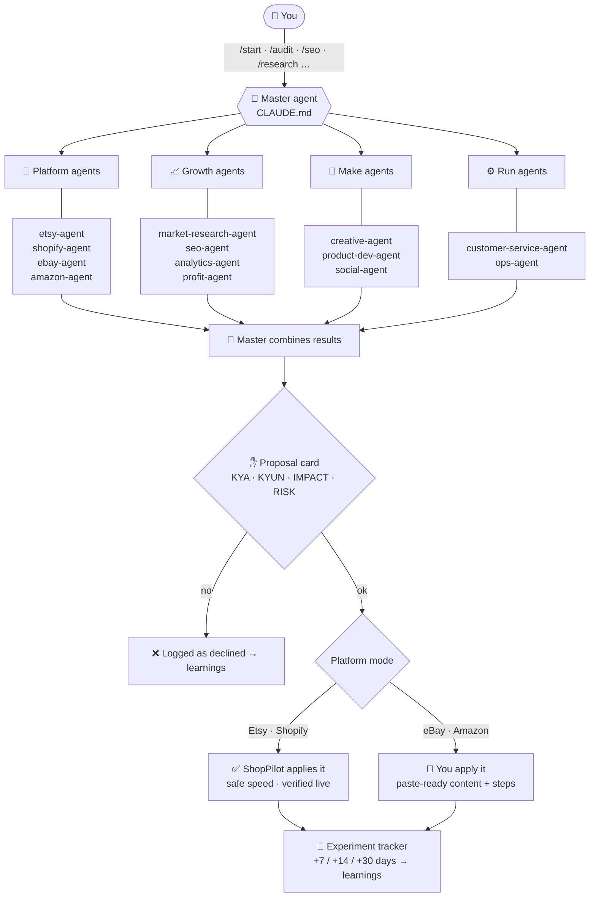

<div align="center">

# 🧭 ShopPilot

### Your AI co-pilot for marketplace growth

A [Claude Code](https://claude.com/claude-code) **master agent + 13 specialist subagents** that audit, research, optimise and grow handmade & home-decor shops — and never change anything without your **ok**.

[](LICENSE)
[](https://claude.com/claude-code)
[](#-platform-support)
[](#-approval-flow)
[](#-privacy)

[Quick start](#-quick-start) · [Commands](#-commands) · [Architecture](#-architecture) · [FAQ](docs/faq.md) · [Hinglish](#-quickstart-hinglish)

</div>

---

## ✨ What it does

| | |
|---|---|
| 🩺 **Shop audits & health checks** | Full account audit + monthly 🟢🟡🔴 health check per platform, always with Top 5 actions |
| 📊 **Analytics** | Sales, conversion, traffic sources, zero-sale listings, ads ROAS — from your own exports |
| 💰 **Profit** | Real profit per product × size × platform after fees and shipping, price floors, break-even ROAS/ACoS |
| 🔎 **SEO — marketplace + Google** | Titles, tags, item specifics, bullets, meta fields, alt text, Merchant Center, Search Console |
| 📈 **Market research** | What's trending, why, how much demand, price bands, competitor gaps, fit with your shop |
| 🧵 **Original new products** | Trend-inspired designs (never copies), colour variants, preview prompts, listing package |
| 🎨 **Creatives** | Room shots from your real photo (design locked), size charts, banners, video ads — 2–3 options with QA |
| 🔁 **Cross-listing, ads, social & service** | One listing → every platform · Etsy Ads / Promoted Listings / PPC · Pinterest & Instagram · buyer-reply drafts |

## 🏗 Architecture



Every subagent reads the same rulebook first — [`AGENT-RULES.md`](.claude/skills/core/AGENT-RULES.md) — then its skills, the platform's `PLATFORM.md`, and your private `data/` folder.

## 🛒 Platform support

| Platform | Mode | What happens after your "ok" |
|---|:---:|---|
| **Etsy** | ✅ Execute after approval | ShopPilot makes the one approved change in your logged-in Shop Manager, at human speed, and verifies it |
| **Shopify** | ✅ Execute after approval | Via a Shopify connector if connected, otherwise Shopify admin in the browser |
| **eBay** | 🧭 Advisor | Paste-ready content, Seller Hub upload CSV, click-by-click steps — you apply it |
| **Amazon** | 🧭 Advisor | Paste-ready content, flat files, bulk sheets, click-by-click steps — you apply it |

> eBay and Amazon are advisor-only on purpose: automated activity on those seller accounts can risk suspension.

## 🚀 Quick start

**1. Clone and enable the privacy hook**

```bash
git clone https://github.com/pr359347-sketch/shoppilot.git
```

```bash
cd shoppilot && git config core.hooksPath .githooks
```

**2. Open the folder in Claude Code** (desktop app or CLI)

```bash
claude
```

**3. Connect your shop**

```
/connect-shop
```

Then drop your marketplace exports into `data/exports/<your-shop>/` ([Etsy](docs/etsy-csv-export-guide.md) · [Shopify](docs/shopify-csv-export-guide.md) · [eBay](docs/ebay-csv-export-guide.md) · [Amazon](docs/amazon-csv-export-guide.md) guides) and run `/start`.

> **No shop yet?** Generic mode still does research, SEO, creatives, product ideas, cross-listing and pricing — just describe your product.

## 🧰 Commands

| Command | Use |
|---|---|
| `/start` | Menu: platform → shop → task |
| `/connect-shop` | Add a shop (private profile + exports folder) |
| `/audit` | Fix one pasted listing, or `/audit <shop>` for a full account audit |
| `/health` | Monthly health check with Top 5 actions |
| `/seo` | Keywords + listing package + Google SEO |
| `/research` | What's selling, why, demand, price bands, fit |
| `/new-product` | Original product ideas → listing package |
| `/creative` | Images, banners, size charts, video — 2–3 options |
| `/ads` | Etsy Ads · eBay Promoted Listings · Amazon PPC · Google Shopping |
| `/report` | `daily` · `evening` · `weekly` · `reminders` · `experiments` |
| `/approvals` | Pending proposals — `ok <ID>` / `no <ID>` |
| `/freeze` | Pause live changes for a shop or area (e.g. sale week) |

<details>
<summary><b>All 13 subagents</b></summary>

| Agent | Role |
|---|---|
| `etsy-agent` | Etsy audits, listing SEO, Etsy Ads, policies, health check |
| `shopify-agent` | Store audit, product pages, collections, Merchant Center, Search Console/GA4, abandoned checkout, page speed |
| `ebay-agent` | 80-char titles, item-specifics score, Terapeak research, Promoted Listings, Markdown Manager |
| `amazon-agent` | Titles/bullets/backend terms, flat files, A+ content, Brand Analytics, PPC harvesting, FBA, suppressed listings |
| `market-research-agent` | Trends, demand, bestsellers, price bands, gaps, fit |
| `seo-agent` | Marketplace keywords + Google SEO (Semrush when connected) |
| `analytics-agent` | Funnel, traffic, zero-sale listings, ROAS, experiments |
| `profit-agent` | Profit per product/size/platform, price floor, break-even |
| `creative-agent` | Image/video creation with design lock + drift QA |
| `product-dev-agent` | Original products from trends, with originality check |
| `social-agent` | Pinterest + Instagram plans and copy |
| `customer-service-agent` | Drafts for messages, reviews, returns, cases |
| `ops-agent` | Daily log, summaries, reminders, freeze, approvals queue |

More: [docs/agents-reference.md](docs/agents-reference.md)
</details>

## ✋ Approval flow

Every live change arrives as a card. Nothing happens until you answer.

```
🟡 PROPOSAL P-260101-01 · <your-shop> · etsy · title
KYA:      Title: "Handmade Wool Rug Beige" → "Hand Tufted Wool Area Rug, Beige Abstract, 5x8 Living Room" (58/140)
KYUN:     High impressions, CTR below 1% — main keyword missing from the first 40 characters
IMPACT:   CTR up within 14 days (measured from Stats)
RISK:     Low — short ranking wobble for 2–3 days
ROLLBACK: Old title saved in the proposal file
→ "ok P-260101-01" / "no P-260101-01" / "change P-260101-01: …"
```

<details>
<summary><b>What happens after "ok"</b></summary>

1. **Freeze check** — frozen shop/area → no execution.
2. **Execute** — Etsy/Shopify: one change, verified live, 45–90 s pause before the next; stops on captcha, "unusual activity" or a login prompt. eBay/Amazon: you get the steps.
3. **Log** — proposal file in `data/approvals/` with old values for rollback.
4. **Measure** — before/after at +7, +14 and +30 days → verdict written to your learnings; future suggestions follow what worked.

</details>

## 🔒 Privacy

- **Your data never leaves your machine through git.** Everything about your business — profiles, costs, exports, reports, approvals, learnings — lives in `data/`, which is git-ignored.
- A **pre-commit hook** blocks anything under `data/`, `reports/`, `exports/`, any `.env` / CSV / Excel file, personal emails, real shop URLs, and every word in your private `data/.private-keywords` list.
- Order exports contain buyer details — agents work with **aggregates only** and never write buyer names or addresses anywhere.
- ShopPilot never types passwords or payment details. You log in; it works inside your session.

<details>
<summary><b>Project layout</b></summary>

```
CLAUDE.md                  master agent — rules, modes, routing
.claude/agents/            13 subagents
.claude/commands/          slash commands
.claude/skills/
  core/                    AGENT-RULES.md + 22 platform-agnostic skills
  etsy/ shopify/ ebay/ amazon/   PLATFORM.md each (+ Etsy skills)
  domain/                  rugs.md, home-textiles.md
scripts/                   etsy_analyze.py
templates/                 shop, brand, settings, proposal, freeze, daily-log, keyword pools
docs/                      export guides, references, FAQ
data/                      your private workspace (git-ignored)
```
</details>

## 🗺 Roadmap

- [x] v0.1 — Etsy module, core skills, privacy guard
- [x] v1.0 — master + 13 subagents, Shopify / eBay / Amazon modules, approval flow, experiment tracking
- [ ] Analysis scripts for Shopify, eBay and Amazon exports
- [ ] More product domains — jewelry, ceramics, wall art, furniture

## 🤝 Contributing

PRs welcome — see [CONTRIBUTING.md](CONTRIBUTING.md) and [docs/adding-a-platform.md](docs/adding-a-platform.md). Questions: [docs/faq.md](docs/faq.md).

## 📄 License

[MIT](LICENSE)

---

## 🇮🇳 Quickstart (Hinglish)

ShopPilot ek **master agent + 13 expert subagents** ka system hai. Aap kaam batao, master plan banata hai, sahi experts se kaam karwata hai, aur har change ko **proposal card** ki tarah dikhata hai (KYA / KYUN / IMPACT / RISK). Aapke **"ok"** ke bina kuch live nahi hota.

- **Etsy + Shopify:** "ok" ke baad ShopPilot khud change karta hai (insaan ki speed se).
- **eBay + Amazon:** sirf advisor. Content, CSV aur steps milenge, change aap karte ho.

1. Repo clone karo, phir `git config core.hooksPath .githooks` chalao.
2. Folder Claude Code me kholo, phir `/connect-shop` chalao.
3. Exports `data/exports/<shop>/` me daalo, phir `/start` chalao.

Aapka saara data sirf `data/` me rehta hai. Wo git me kabhi nahi jaata.
